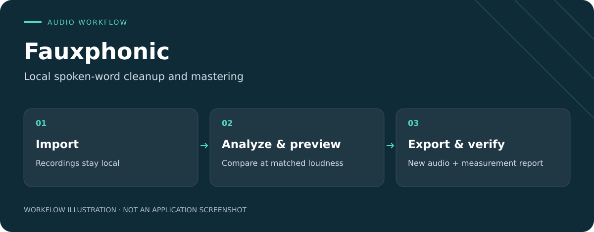

<p align="center"></p>

# Fauxphonic

**Clean up spoken-word recordings, compare the result, and export with measured loudness checks.**

[Download for Windows](https://github.com/Lipton1010/Fauxphonic/releases/tag/v0.2.3) · [First session](#first-session) · [Evidence and limits](#evidence-and-limits) · [Build from source](#development)



*Workflow illustration, not a screenshot or an audio-quality comparison.*

- **Local by design.** Native Windows interface and CPU audio worker; no cloud upload during processing.
- **Compare before committing.** Analyze tracks and build an A/B preview at matched loudness.
- **Keep the originals.** Export to new files and inspect the post-encode measurement report.

**Available now:** [v0.2.3 installer and portable build](https://github.com/Lipton1010/Fauxphonic/releases/tag/v0.2.3), for supported 64-bit Intel/AMD Windows systems. The installer is unsigned. See platform requirements and limitations below.

A native Windows application for local spoken-word cleanup and mastering. Audio processing runs in a separate CPU worker. No browser, account, subscription, cloud upload, GPU setup or runtime download is required.

## Install and launch

Download the current [Fauxphonic 0.2.3 release](https://github.com/Lipton1010/Fauxphonic/releases/tag/v0.2.3):

- **Installer:** download [Fauxphonic-0.2.3-Setup.exe](https://github.com/Lipton1010/Fauxphonic/releases/download/v0.2.3/Fauxphonic-0.2.3-Setup.exe), double-click it, then open Fauxphonic from the Start menu or desktop shortcut. This is a single-file installer; no separate `.bin` files are needed. Installation is per user and includes the worker, codecs and pinned activity model.
- **Portable:** download [Fauxphonic-0.2.3-Windows-portable.zip](https://github.com/Lipton1010/Fauxphonic/releases/download/v0.2.3/Fauxphonic-0.2.3-Windows-portable.zip), extract the entire ZIP, then open `Fauxphonic/Fauxphonic.exe` inside the extracted folder. Keep the entire folder together.
- **Checksums:** [SHA256SUMS.txt](https://github.com/Lipton1010/Fauxphonic/releases/download/v0.2.3/SHA256SUMS.txt) contains the SHA-256 hashes for both downloads.

The installer is unsigned. Windows may show an unknown-publisher warning. Do not use the withdrawn 0.1.0 installer. Close and uninstall 0.1.0 before installing 0.2.3; recordings, projects and application data remain intact.

The supported platform is 64-bit Intel/AMD Windows 10 (1809+) or Windows 11 with Media Foundation. Windows N needs the Microsoft Media Feature Pack; Fauxphonic does not install system components.

Version 0.2.3 fixes waveform analysis when a separate data directory is selected: analysis scratch stays within that directory. It also includes the 0.2.2 fixes for playback loading/resume, mastering convergence, damaged-WAVE validation, silent-file reporting, stale A/B results and queued output collisions. Cleanup uses a measured stationary noise profile, de-essing adapts to recording level, and leveler defaults provide more correction. Cleanup can explicitly bypass when no suitable noise-only sample is found. The app uses a teal waveform F icon with a brass signal accent on deep navy; see [visual identity](docs/visual_identity.md).

The release page describes the current downloads and verification. `docs/STATUS.md` contains historical build evidence. Paths such as `dist/installers/` and `dist/Fauxphonic/` are developer build outputs, not downloads included with a source checkout; see [Development](#development) if building from source.

## First session

1. Import files or drop a folder. Assign mono voice recordings the **Speech** role. Use explicit offsets when recordings do not share a start; 48,000 samples is one second. Stereo and music are not silently downmixed or passed through mono-only cleanup.
2. Choose **Natural speech** for conservative spectral cleanup and phrase leveling, **Strong cleanup** for more suppression, or **Master only** for loudness/export processing. Start around -19 LUFS for mono or -16 LUFS for stereo and adjust for your destination.
3. Analyze a selected track. Build an A/B preview up to 30 seconds and compare at matched loudness if desired. Short clips and end-of-file selections are supported. The first uncached preview renders the full program; comparison gain never changes the export.
4. Choose **Export audio…** (**Queue render…** in 0.2.1) and a **new** WAV, FLAC, MP3, AAC/M4A or Opus filename. Check the verification result, then use **Play export**. The adjacent `.report.json` is a measurement report, not the audio. A failed export is withheld; existing media and reports are not overwritten.

Advanced controls include editable source-local gain curves, broad EQ, bounded dynamic high-band attenuation, music ducking, and opt-in correlated bleed attenuation. Speech overlap that does not meet the conservative bleed detector's requirements stays unchanged. Detection hold requires a continuous match before attenuation; it does not extend a cut through uncertain speech. Individual tracks can be protected.

Optional aligned stems retain the full project timeline and are pre-master. Lossy master formats use lossless WAV stems. Independently normalized stems are not produced, and pre-master stems need not sum to the mastered delivery file. Output tags contain only values you enter. Never trim speaker recordings independently to align them.

The Capabilities dialog shows the actual model/tool hashes and unavailable capabilities. You can select model storage and import the exact pinned Silero artifact offline. Missing or altered selected models fail visibly; the worker does not substitute a different model or silently fall back to bundled storage.

Playing compressed media or an explicitly selected container stream first prepares a temporary PCM WAV locally in the worker. This preserves the selected stream and presentation timeline without requiring an Opus codec pack. Preparation is cancellable; playback files are cleaned up by the app.

## Evidence and limits

Silero VAD detects speech activity for leveling, noise-profile selection, ducking and bleed analysis; it is not a neural denoiser or speaker identifier. FastEnhancer research inference was tested, but its checkpoint redistribution rights and quality gate remain unresolved. DeepFilterNet, neural dereverberation and regenerative restoration are unavailable. Plosive attenuation was not enabled because its protection proof failed.

WAV24/FLAC are lossless delivery choices. MP3 uses 96/192 kbps for mono/stereo, AAC uses 96/192 kbps, and Opus uses 64/128 kbps. Actual decoded output is checked after encoding. AAC presentation duration and codec padding are recorded separately. Strict peak/loudness combinations can fail after bounded corrective passes; the app does not report them as successful.

The project rate is 48 kHz, with explicit mono/stereo layouts, nonnegative sample offsets and at most 32 tracks. Jobs restart from originals after interruption; they do not resume recurrent state midway. Long processing uses fixed blocks and disk-backed RF64 scratch. Initial uncached preview needs scratch space for a complete render. Analysis noise estimates and clipping candidates are heuristics, not a quality score or damage diagnosis.

No human listening approval, Auphonic equivalence, or actual 16 GB GPU compatibility is claimed. Production processing is CPU-only; the development machine has a 24 GB GPU. Optional transcription, reviewed silence editing, video replacement and watch folders are absent. See `docs/feature_parity.md` and `docs/model_decisions.md` for the capability boundaries.

## Development

Python 3.12.10 and runtime packages are pinned with hashes in `locks/desktop.lock`. Dependency/model acquisition is an explicit setup action. Nothing is downloaded during normal audio processing.

```powershell
powershell -ExecutionPolicy Bypass -File scripts/bootstrap.ps1
.venv/Scripts/python.exe run_worker.py doctor --json
.venv/Scripts/python.exe run_worker.py process "input.wav" --preset natural-speech --output "new-master.wav"
.venv/Scripts/python.exe run_worker.py analyze "input.wav" --report "analysis.json"
.venv/Scripts/python.exe run_worker.py render-project "session.fauxphonic.json" --output "mix.flac"
.venv/Scripts/python.exe -m pytest -q
powershell -ExecutionPolicy Bypass -File scripts/build_windows.ps1
powershell -ExecutionPolicy Bypass -File scripts/build_installer.ps1
```

Development launch: double-click `Launch Fauxphonic.vbs` after bootstrap. Native dependency build recipes, exact sources/hashes and license texts accompany the packaged application under `legal/sources`, `licenses` and the third-party inventory. `docs/packaging.md` describes reproduction and acceptance commands.

Project/report JSON contains absolute local media paths; treat it as private. Original media, downloaded model weights, caches and binaries are excluded from Git. Queue/caches live in per-user application data. Failed/cancelled work does not promote partial audio; a forced termination can leave app-owned scratch for later cleanup. Uninstall removes installed application files, not user recordings, projects or exports.

Local operating records, experiments and generated verification evidence are intentionally excluded from source control.
